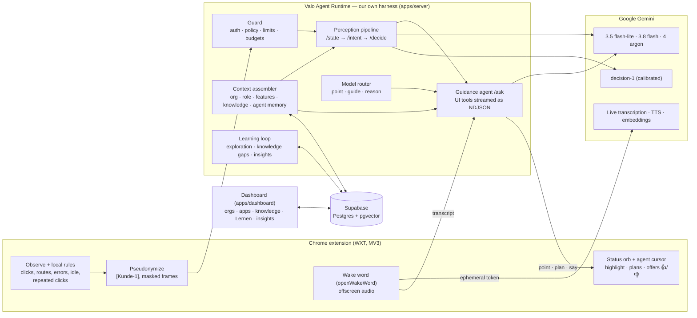
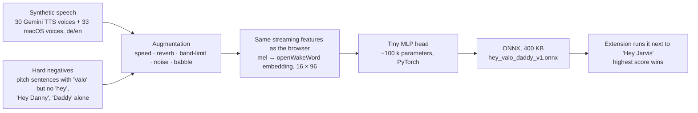

# Valo — the co-pilot that teaches people their business apps

Valo watches how employees use a web app (e.g. CORPUS, an internal fleet/operations tool), notices **when someone is stuck**, and shows the way **on the page itself**: an agent cursor glides to the right field, highlights it, and — only if needed — says one short sentence. Ask by voice ("Hey Valo, wie ändere ich die IBAN?") or just keep working; Valo offers help on its own and gets quieter the more you know. It never clicks for you: people learn instead of being replaced.

Built in one day at the [{Tech: Europe} Agentic AI Hack Karlsruhe](https://luma.com/kar-hack) — **100 % Google Gemini**, running on our **own agent harness**.

## Architecture



Three independently runnable apps share one contract (`packages/shared`, zod): **extension** → **runtime** (all Gemini calls, port 3001) → **dashboard** (port 3000).

## The harness — built from scratch

We use the Vercel AI SDK only as the thin model-call layer. **Everything that makes an agent useful here is our own code**:

| Part | What it does | Code |
| --- | --- | --- |
| **Staged perception pipeline** | Separate Gemini inferences: UI state → workflow & intent → intervention decision → guidance. Each step is small, fast and inspectable. | [`api/lotse/{state,intent,decide,ask}`](apps/server/src/app/api/lotse) · [`observe.ts`](apps/server/src/lib/lotse/observe.ts) |
| **Model router** | Heuristics first, Gemini **Decisions API** as tie-breaker → tier `point` (one marker, flash-lite, minimal thinking), `guide` (multi-step plan, tools), `reason` (gemini-4-argon). Per-tier model, thinking level, step limit, token cap, timeout. | [`orchestrator.ts`](apps/server/src/lib/lotse/orchestrator.ts) |
| **Calibrated "should I interrupt?"** | `gemini-decision-1` answers "needs help?" with calibrated confidence + "which feature?" in one call; **per-user threshold learns from 👍/👎**; explicit triggers (e.g. ≥ 5 clicks on a disabled button). | [`decide.ts`](apps/server/src/lib/lotse/decide.ts) · [`prefs.ts`](apps/server/src/lib/lotse/prefs.ts) |
| **Context assembly** | Page host → org → **role-filtered feature graph**, org knowledge base (pgvector), **agent memory**, observation history, screenshots as real multimodal parts — delimited as untrusted data. | [`context.ts`](apps/server/src/lib/lotse/context.ts) · [`prompt.ts`](apps/server/src/lib/lotse/prompt.ts) · [`images.ts`](apps/server/src/lib/lotse/images.ts) |
| **Streaming UI tools** | `pointTo`, `showPlan`, `say` reach the browser **the moment the model calls them** (NDJSON); multi-step plans then advance locally after each click — no extra round trip. | [`agent.ts`](apps/server/src/lib/lotse/agent.ts) · [`content.ts`](apps/extension/entrypoints/content.ts) |
| **Voice around one brain** | Local wake word ([own trained model](#our-own-wake-word--trained-during-the-hackathon)) → Gemini Live transcription (single-use, transcription-locked token) → same guidance path → Gemini TTS **only** for `say`, max. 2 sentences, silent when a marker answers it. | [`live-token`](apps/server/src/app/api/lotse/live-token) · [`tts`](apps/server/src/app/api/lotse/tts) · [`utils/voice`](apps/extension/utils/voice) |
| **Guardrails** | Pseudonymization **in the browser** before anything leaves it, prompt-injection delimiting, org policy with blocked routes (fleet pages never observed), rate limits, token budgets, timeouts, kill switch, **every model call traced**. | [`pseudonymize.ts`](apps/extension/utils/pseudonymize.ts) · [`guard.ts`](apps/server/src/lib/lotse/guard.ts) · [`policy.ts`](apps/server/src/lib/lotse/policy.ts) · [`usage.ts`](apps/server/src/lib/lotse/usage.ts) |
| **Learning over weeks** | Admin-started **exploration** maps the app once; a learning loop every 10 min finds stale click paths, agent errors and knowledge gaps; **agent memory** is promoted only with evidence from ≥ 5 people; insights → training & UX suggestions (aggregates only). | [`learn.ts`](apps/server/src/lib/lotse/learn.ts) · [`memory.ts`](apps/server/src/lib/lotse/memory.ts) · [`gaps.ts`](apps/server/src/lib/lotse/gaps.ts) · [`lib/insights`](apps/server/src/lib/insights) |

**Measured locally (2026-11-14):** first highlight **≈ 0.9 s** · 7-step plan ≈ 1.1 s · interrupt decision 0.2–0.5 s · voice token 0.3–0.6 s.

**Why not an off-the-shelf harness?** We need sub-second, real-time guidance with tools that run **in the user's browser**, Gemini-only with our own key, and strict privacy (works council, GDPR) — generic agent frameworks optimize for long-running chat agents instead.

## Our own wake word — trained during the hackathon

We started with openWakeWord's pre-trained **"Hey Jarvis"** (open weights, ONNX). It runs fully in the browser (ONNX Runtime Web in the extension's offscreen document), so no audio leaves the device before the trigger. There is no model for our own name, so we **trained our own keyword head for "Hey Valo" and "Hey Daddy"** — in about 30 minutes on a laptop, without a single recorded human voice:




On voices the model never heard, it catches ~97 % of "Hey Valo" / "Hey Daddy" clips, while pitch sentences that only mention "Valo" stay near 0 (chart above: real scores from the shipped model). Known weak spot: near-homophones like "Hey Danny". Model: [`public/wakeword/hey_valo_daddy_v1.onnx`](apps/extension/public/wakeword/hey_valo_daddy_v1.onnx) · detector: [`wakeword.ts`](apps/extension/utils/voice/wakeword.ts) · decision: [D-38](docs/decisions.md).

## Why Valo

- **Notices on its own** when someone is stuck — no admin-built tours.
- **Gets quieter** the better you get (adaptive per-user threshold).
- **Learns where the app loses people, never who** — aggregates only, pseudonymized in the browser.
- **Shows, doesn't act.** Competitor check: [docs/research.md](docs/research.md#competitors-2026-11-14).

## Run it

```bash
npm install && npm run db:start && npm run db:env   # then put GEMINI_API_KEY into .env.local
npm run doctor                                       # all ✓
npm run dev:server      # runtime  → http://localhost:3001
npm run dev:dashboard   # admin    → http://localhost:3000  (admin@demo.test / demo1234, test data)
npm run demo:crm        # demo app → http://localhost:4000
npm run build -w @lotse/extension   # load apps/extension/.output/chrome-mv3 via chrome://extensions → "Load unpacked"
```

| Folder | |
| --- | --- |
| `apps/extension` | Chrome extension — observe, pseudonymize, orb/cursor/plans, voice |
| `apps/server` | Valo Agent Runtime — the harness, all Gemini calls |
| `apps/dashboard` | Org admin — apps, features, knowledge, learning suggestions, insights |
| `packages/shared` | The contract (zod schemas + types) |
| `demo-crm` | Static demo CRM with scenarios to try Valo on |
| `docs` | Product wiki: [requirements](docs/requirements.md), [architecture](docs/architecture.md), [decisions D-01…D-30](docs/decisions.md) |

Setup details: [SETUP.md](SETUP.md) · Guide for coding agents: [AGENTS.md](AGENTS.md) · Runtime API: [apps/server/RUNTIME.md](apps/server/RUNTIME.md)
