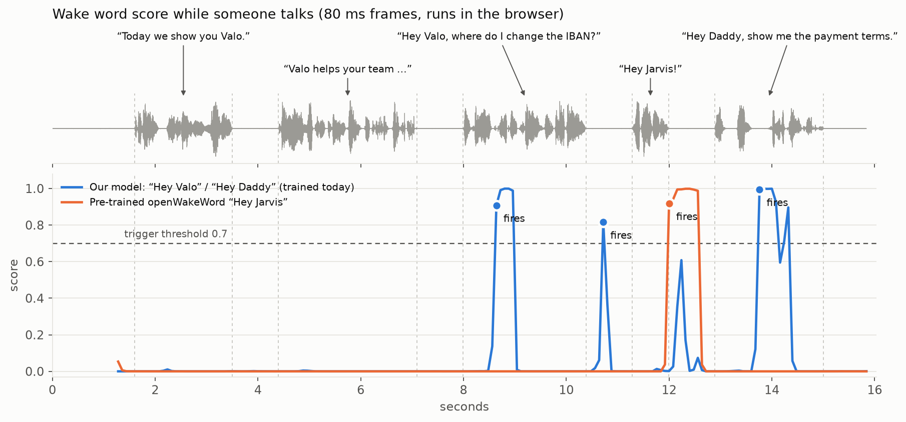

# Valo

**AI onboarding coach for business web apps: it notices when someone is stuck, shows where to click, and gets quieter as you learn.**

Built in one day at the [{Tech: Europe} Agentic AI Hack Karlsruhe](https://luma.com/kar-hack) (14 Nov 2026). It runs entirely on Google Gemini, on an agent harness we wrote ourselves.

## Problem

Companies buy new business software and their people don't use it. Our customer, **Fuller GmbH**, sees this with its internal app **CORPUS**: employees spend minutes looking for a function by hand, ask a colleague, or go back to the old way. Training sessions are forgotten by the next week, and nobody can tell whether the app or the training is to blame.

## What Valo does

- **Runs as a browser extension next to any web app.** The app itself needs no code changes and no SDK snippet.
- **Offers help on its own.** Local rules spot stuck signals (repeated clicks, empty searches, idle time, errors). The Gemini **Decisions API** then gives a calibrated "needs help?" answer, and Valo only speaks up above a **per-person threshold that adapts to 👍/👎 feedback** ([D-22](docs/decisions.md)).
- **Points instead of clicking.** A spotlight, an arrow and an agent cursor mark the right field, and multi-step plans move forward as you click. Valo **shows and never acts**, so people learn the app instead of handing it over ([D-17](docs/decisions.md)).
- **Answers by voice.** You say "Hey Valo, how do I change the IBAN?" A wake word model that we trained ourselves runs in the browser, and the answer is spoken only when a marker alone can't answer the question ([D-16](docs/decisions.md), [D-38](docs/decisions.md)).
- **Explores the app once, with an admin.** One guided crawl produces the feature list (routes, click paths, roles) plus design findings ([D-25](docs/decisions.md)).
- **Keeps learning, with admin approval.** It records stale click paths, knowledge gaps and recurring questions. Agent memory becomes active only with evidence from at least 5 people or after an admin approves it ([D-28](docs/decisions.md)).
- **Pseudonymizes in the browser.** Names, emails and IDs are replaced, and frames are masked, before anything leaves the machine ([D-26](docs/decisions.md)).
- **Dashboard for the organization:**
  - Insights that separate "fix the app" from "needs training"
  - Learning review
  - Knowledge base (pgvector)
  - Trainings suggested from real employee questions
  - Team and roles

## What's different

We checked about 20 products: digital adoption platforms (WalkMe, Whatfix, Userlane, Pendo …), AI browser agents (Gemini in Chrome, Claude for Chrome, Atlas …) and friction analytics tools (Fullstory, PostHog …). Full table: [docs/research.md](docs/research.md#competitors-2026-11-14).

| Gap we found | Valo |
| --- | --- |
| Hints never fade | **Fading per person**: the threshold rises as you decline or rate down offers. |
| Nobody separates a design flaw from a training need | **"Still stuck after the hint"** metric: if people stay stuck after being shown the way, the app needs fixing. If not, they need training. |
| Analytics tracks individuals | **Aggregate-only**: reports need at least 5 people, and there are no per-person views. |
| Guides are built by hand | **Zero setup**: one exploration run, then live stuck detection with an LLM gate. |
| AI agents click for you | **Shows, never acts**: the goal is people who can use the app themselves. |
| Enterprise pricing and rollout | Built for **SMBs**: install the extension and it's running. |

## Architecture

```
 Employee browser                    Valo runtime (apps/server)                Google Gemini
┌─────────────────────────┐ events  ┌────────────────────────────────┐       ┌────────────────────────┐
│ Chrome extension (MV3)  │ ──────▶ │ guard · policy · limits        │ ────▶ │ 3.5 flash-lite ·       │
│  observe + local rules  │         │ /state → /intent → /decide     │       │ 3.8 flash · 4 argon    │
│  pseudonymize           │ ◀────── │ guidance agent /ask (NDJSON)   │ ────▶ │ Decisions API          │
│  orb · cursor · spot-   │ point · │ learning loop · insights       │       │ (decision-1)           │
│  light · plans          │ plan ·  │                                │ ────▶ │ Live transcription,TTS │
│  wake word (ONNX)       │ say     └───────────────┬────────────────┘       │ embeddings (768)       │
└───────────┬─────────────┘                         │                        └────────────────────────┘
            │ audio after the wake word,            ▼
            │ single-use token            ┌──────────────────────────────┐      ┌──────────────────────┐
            └──────────────▶ Gemini Live  │ Supabase Cloud (eu-central-1)│ ◀──▶ │ Dashboard            │
                                          │ Postgres · pgvector · Auth   │      │ (apps/dashboard)     │
                                          │ RLS on every table           │      │ org admins           │
                                          └──────────────────────────────┘      └──────────────────────┘
```

- **Three apps, one contract.** The extension, the runtime (all Gemini calls) and the dashboard each run on their own. They share only the zod schemas in `packages/shared` and the database.
- **Hosting ([D-39](docs/decisions.md)).** The dashboard and server run on **Codesphere** at https://691180.1.cloud.codesphere.com (`/` → dashboard, `/api` → server). Database, auth and vector search are on **Supabase Cloud** (EU). Details: [docs/hosting-codesphere.md](docs/hosting-codesphere.md).

### The harness: built from scratch

The Vercel AI SDK is only the thin layer that calls the model. **Everything that makes the agent useful is our own code:**

| Part | What it does | Code |
| --- | --- | --- |
| **Staged perception pipeline** | Separate Gemini inferences: UI state → workflow & intent → intervention decision → guidance. Each step is small, fast and inspectable. | [`api/lotse/{state,intent,decide,ask}`](apps/server/src/app/api/lotse) · [`observe.ts`](apps/server/src/lib/lotse/observe.ts) |
| **Model router** | Heuristics first, with the Gemini **Decisions API** as tie-breaker. It picks one of three tiers: `point` (one marker, flash-lite, minimal thinking), `guide` (multi-step plan, tools) or `reason` (gemini-4-argon). Each tier has its own model, thinking level, step limit, token cap and timeout. | [`orchestrator.ts`](apps/server/src/lib/lotse/orchestrator.ts) |
| **Calibrated "should I interrupt?"** | One `gemini-decision-1` call answers "needs help?" with calibrated confidence and "which feature?". The **per-user threshold learns from 👍/👎**. Explicit triggers bypass it (e.g. ≥ 5 clicks on a disabled button). | [`decide.ts`](apps/server/src/lib/lotse/decide.ts) · [`prefs.ts`](apps/server/src/lib/lotse/prefs.ts) |
| **Context assembly** | Page host → org → **role-filtered feature graph**, plus the org knowledge base (pgvector), **agent memory**, observation history and screenshots as real multimodal parts. All of it is delimited as untrusted data. | [`context.ts`](apps/server/src/lib/lotse/context.ts) · [`prompt.ts`](apps/server/src/lib/lotse/prompt.ts) · [`images.ts`](apps/server/src/lib/lotse/images.ts) |
| **Streaming UI tools** | `pointTo`, `showPlan` and `say` reach the browser **the moment the model calls them** (NDJSON). Multi-step plans then advance locally after each click, with no extra round trip. | [`agent.ts`](apps/server/src/lib/lotse/agent.ts) · [`content.ts`](apps/extension/entrypoints/content.ts) |
| **Voice around one brain** | Local wake word → Gemini Live transcription (single-use, transcription-locked token) → the same guidance path → Gemini TTS **only** for `say` (max. 2 sentences). Valo stays silent when a marker answers the question. | [`live-token`](apps/server/src/app/api/lotse/live-token) · [`tts`](apps/server/src/app/api/lotse/tts) · [`utils/voice`](apps/extension/utils/voice) |
| **Guardrails** | Pseudonymization **in the browser**, prompt-injection delimiting, org policy with blocked routes, rate limits, token budgets, timeouts and a kill switch. **Every model call is traced.** | [`pseudonymize.ts`](apps/extension/utils/pseudonymize.ts) · [`guard.ts`](apps/server/src/lib/lotse/guard.ts) · [`policy.ts`](apps/server/src/lib/lotse/policy.ts) · [`usage.ts`](apps/server/src/lib/lotse/usage.ts) |
| **Learning over weeks** | An admin-started **exploration** maps the app once. A learning loop runs every 10 min and finds stale click paths, agent errors and knowledge gaps. **Agent memory** is promoted only with evidence from ≥ 5 people. Insights turn into training and UX suggestions (aggregates only). | [`learn.ts`](apps/server/src/lib/lotse/learn.ts) · [`memory.ts`](apps/server/src/lib/lotse/memory.ts) · [`gaps.ts`](apps/server/src/lib/lotse/gaps.ts) · [`lib/insights`](apps/server/src/lib/insights) |

**Measured locally (14 Nov 2026):**

| Step | Time |
| --- | --- |
| First highlight | ≈ 0.9 s |
| 7-step plan | ≈ 1.1 s |
| Interrupt decision | 0.2–0.5 s |
| Voice token | 0.3–0.6 s |

**Why not an off-the-shelf harness?** We need real-time guidance in under a second, with tools that run **in the user's browser**, on Gemini only, with our own key, and with strict privacy (works council, GDPR). Generic agent frameworks are built for long-running chat agents instead.

### Our own wake word, trained during the hackathon

We started with openWakeWord's pre-trained **"Hey Jarvis"** model. No model existed for our own name, so we **trained our own keyword head for "Hey Valo" and "Hey Daddy"**. It took about 30 minutes on a laptop and used no recorded human voices: all training audio is synthetic (Gemini TTS and macOS voices). The 400 KB model scores the audio every 80 ms in the browser (ONNX Runtime Web), and **the microphone stream leaves the laptop only after the wake word**.



| Held-out voices (never seen in training), threshold 0.7 | Clips | Fired |
| --- | --- | --- |
| "Hey Valo" / "Hey Daddy" | 72 | **96 %** |
| Office and pitch sentences, incl. "Today we show you Valo." | 114 | **< 1 %** (1 clip) |
| Near misses ("Hey Danny", "Hey Paolo" …) | 74 | 7 % |

- Model: [`hey_valo_daddy_v1.onnx`](apps/extension/public/wakeword/hey_valo_daddy_v1.onnx)
- Detector: [`wakeword.ts`](apps/extension/utils/voice/wakeword.ts)
- Training pipeline, data manifest, metrics and samples: [`ml/wakeword`](ml/wakeword)

## Tech stack

| Layer | Technology |
| --- | --- |
| Models | Gemini `gemini-3.8-flash`, `gemini-4-argon`, `gemini-3.5-flash-lite`, Decisions API `gemini-decision-1`, Live transcription, `gemini-3.8-flash-tts`, `gemini-embedding-2` (768 dims) |
| Agent layer | Vercel AI SDK 7 (`ai` 7.0) + `@ai-sdk/google` 4.0 + `@google/genai` 3.3 (fallback); harness is our own code |
| Server + dashboard | Next.js 16.4.6 (App Router, Turbopack), React 19.3, Tailwind CSS 4.3 |
| Extension | WXT 0.21.5, Chrome MV3, ONNX Runtime Web 1.23 (wake word) |
| Data | Supabase (Postgres, pgvector, Auth), `@supabase/supabase-js` 2.119, `@supabase/ssr` 0.12 |
| Contract | zod 4.6 in `packages/shared`, TypeScript 5 |
| Wake word training | Python, PyTorch, openWakeWord features → ONNX |
| Hosting | Codesphere (dashboard + server), Supabase Cloud eu-central-1 |

## Privacy & security

- **Pseudonymized in the browser** before anything is sent. The server never sees names, emails or customer IDs from the page ([D-26](docs/decisions.md)).
- **Aggregates only**: insights, knowledge gaps and agent memory need at least 5 distinct people. Admins never see an individual's history, and each person's adaptive threshold is private.
- **Row-level security on every table.** Blocked routes in the org policy are never observed ([D-27](docs/decisions.md)).
- **Per-person data export and deletion** ([D-33](docs/decisions.md)).
- **No self sign-up on the hosted version.** Admins add members.
- **Secrets only as hosting workspace variables**, never in the repo (this repo is public). Data stays in the **EU region** (Supabase eu-central-1).

## Demo

Everything runs **hosted**: dashboard and runtime on Codesphere, data on Supabase Cloud (EU). Nothing runs on localhost in the demo.

What we show live:

1. **CORPUS** on Fuller's dev system (`dev.fuller.de`, sample data only, *Fuller GmbH (Demo)*): the extension on a real business app, without touching its code. Valo notices when someone is stuck, puts a spotlight on the right control, walks a multi-step plan, and answers "Hey Valo, …" by voice, in the language of the question.
2. **Dashboard** (https://691180.1.cloud.codesphere.com): install the extension, the exploration result, the learning review (approve or reject agent memory), insights ("fix the app" vs "training"), the knowledge base and trainings.

### How to try

1. Open the hosted dashboard **https://691180.1.cloud.codesphere.com/install** and download the extension (it is built during deployment and already points to the hosted runtime).
2. Unzip it, open `chrome://extensions`, switch on **Developer mode**, click **Load unpacked** and pick the unzipped folder. Chrome does not allow one-click installs from websites; for company-wide rollout IT can force-install Valo via Chrome policy.
3. Pin Valo, reload the app tab and sign in with your Valo account in the side panel (**⌘⇧L** / **Alt+L** opens Valo, **⌘⇧K** asks by voice).

The hosted version is invite-only (no self sign-up): **access on request**. To run everything on your own machine, see [Local development](#local-development).

## Team

| Name | Area |
| --- | --- |
| Luca | Server / agent runtime (`apps/server`) |
| Nils | Chrome extension (`apps/extension`) |
| Ismail | Dashboard, database & hosting (`apps/dashboard`, `supabase/`) |

## Built at the hackathon

The starter template (Next.js + local Supabase, team setup docs) was committed on 13 Nov. All product code was written from the kickoff on 14 Nov. Highlights from `git log` (14 Nov):

| Time | Milestone |
| --- | --- |
| 11:32 | Product wiki: requirements, architecture, decisions, competitor check |
| 11:52 | Repo split into server, dashboard and extension workspaces |
| 12:14 | Dashboard: login, insights, apps & feature lists, trainings, team |
| 12:24 | Central agent runtime: model tiers, NDJSON guidance, Decisions API, adaptive proactivity |
| 13:20 | Voice: wake word, Gemini Live transcription, Gemini TTS |
| 13:47 | Browser-side pseudonymization before anything leaves the browser |
| 13:55 | Admin exploration maps the app → feature list |
| 14:22 | Rebrand Lotse → Valo |
| 15:44 | Learning loop: agent memory review, knowledge gaps, helpful-offer stats (≥ 5 people) |
| 16:37 | Our own "Hey Valo" wake word model |
| 17:01 | Hosting: Supabase Cloud + Codesphere |
| 17:40 | Hosted voice: access token on Live and TTS calls |
| 17:51 | Extension download in the hosted dashboard (`/install`) |
| 17:59 | Answers pinned to the language of the question; spoken questions get spoken answers |

## Development

### Repo layout

| Folder | Package | Port | What |
| --- | --- | --- | --- |
| `apps/extension` | `@lotse/extension` | 3002 (WXT dev) | Chrome extension: observe, pseudonymize, orb/cursor/plans, voice |
| `apps/server` | `@lotse/server` | 3001 | Valo Agent Runtime: the harness, all Gemini calls |
| `apps/dashboard` | `@lotse/dashboard` | 3000 | Org admin: apps, features, knowledge, learning, insights, trainings, team |
| `packages/shared` | `@lotse/shared` | – | The contract (zod schemas + types) |
| `supabase` | – | 573xx | Migrations (schema source of truth) and seed data |
| `demo-crm` | – | 4000 | Static demo CRM with scenarios to try Valo on |
| `ml/wakeword` | – | – | Wake word training pipeline |
| `docs` | – | – | Product wiki: [requirements](docs/requirements.md), [architecture](docs/architecture.md), [decisions](docs/decisions.md), [research](docs/research.md) |

Internal package names keep the old project name `lotse` ([D-32](docs/decisions.md)).

### Local development

You need Node ≥ 22, Docker, the Supabase CLI, Python 3, Chrome and a Gemini API key.

```bash
npm install
npm run db:start        # local Supabase in Docker
npm run db:env          # writes .env.local, then add GEMINI_API_KEY to it
npm run dev:server      # runtime   → http://localhost:3001
npm run dev:dashboard   # dashboard → http://localhost:3000 (the demo login is shown on the local login page only)
npm run demo:crm        # optional: static demo CRM for development → http://localhost:4000
npm run build -w @lotse/extension
# chrome://extensions → Developer mode → "Load unpacked" → apps/extension/.output/chrome-mv3
```

The extension talks to `http://localhost:3001` by default. For a hosted build: `WXT_LOTSE_SERVER_URL=https://<workspace> npm run build -w @lotse/extension`.

### Scripts (repo root)

<!-- AUTO-GENERATED from package.json -->
| Command | What it does |
| --- | --- |
| `npm run dev:server` | Agent runtime → http://localhost:3001 |
| `npm run dev:dashboard` | Dashboard → http://localhost:3000 |
| `npm run dev:extension` | WXT dev (port 3002), opens Chrome with the extension |
| `npm run build` | Build all workspaces |
| `npm run lint` | Lint all workspaces |
| `npm run typecheck` | Typecheck all workspaces |
| `npm run demo:crm` | Static demo CRM for development → http://localhost:4000 |
| `npm run db:start` | Start the local Supabase (Docker) |
| `npm run db:stop` | Stop the local Supabase (data is kept) |
| `npm run db:status` | Show local Supabase URLs and keys |
| `npm run db:env` | Write the root .env.local with the local Supabase keys |
| `npm run db:reset` | Rebuild the local DB from migrations + seed (deletes local data) |
| `npm run db:migration` | New SQL migration: npm run db:migration <name> |
| `npm run db:types` | Regenerate packages/shared/src/database.types.ts |
| `npm run ai:check` | Smoke-test the Gemini key (text, JSON, embeddings) |
| `npm run doctor` | Check tools, Docker, Supabase, .env.local, Gemini key |
<!-- /AUTO-GENERATED -->

One workspace only: `npm run <script> -w @lotse/server` (or `@lotse/dashboard`, `@lotse/extension`, `@lotse/shared`).

### Environment variables

Local: one `.env.local` at the repo root (`npm run db:env` writes the Supabase part). Hosted: Codesphere workspace variables (see [Hosting](#hosting)).

<!-- AUTO-GENERATED from .env.example -->
| Variable | Required | Description |
| --- | --- | --- |
| `NEXT_PUBLIC_SUPABASE_URL` | yes | Copy to .env.local, or generate it with `npm run db:env` while local Supabase runs. |
| `NEXT_PUBLIC_SUPABASE_PUBLISHABLE_KEY` | yes | – |
| `SUPABASE_SECRET_KEY` | yes | Server-only. Bypasses RLS — never expose to the browser. |
| `GEMINI_API_KEY` | yes | Google Gemini — server-only. Get a key at https://aistudio.google.com/apikey |
| `LOTSE_DISABLED` | no | Kill switch: 1 = every /api/lotse/* call answers 503. |
| `LOTSE_DEV_AUTH` | no | Allow anonymous calls (identity = x-lotse-session) even when NODE_ENV=production. Always allowed in dev. |
| `LOTSE_KNOWLEDGE_SOURCE` | no | Feature knowledge: "auto" (default: dashboard tables apps/app_features, bundled demo-CRM fixture as fallback), "db" (same, warns when the app is missing) or "fi… |
| `LOTSE_TIER_CLASSIFIER` | no | 0 = never call the Decisions API to break ties in tier selection (heuristic only). |
| `LOTSE_LIMIT_ASK_PER_MIN` | no | Requests per minute per caller (user id, else x-lotse-session). Defaults: ask 20, state 60, intent 60, decide 60, events 6, prefs 20. state/intent/decide run on… |
| `LOTSE_LIMIT_STATE_PER_MIN` | no | – |
| `LOTSE_LIMIT_INTENT_PER_MIN` | no | – |
| `LOTSE_LIMIT_DECIDE_PER_MIN` | no | – |
| `LOTSE_LIMIT_EVENTS_PER_MIN` | no | – |
| `LOTSE_LIMIT_PREFS_PER_MIN` | no | – |
| `LOTSE_TIMEOUT_STATE_MS` | no | Model timeouts (ms) for /state and /intent. Defaults 6000 / 8000 (the extension aborts after 20 s). |
| `LOTSE_TIMEOUT_INTENT_MS` | no | – |
| `LOTSE_LIMIT_LIVE_TOKENS_PER_MIN` | no | Voice sessions per minute (one Live token = one spoken question, NOT LLM tokens). Defaults: 8 per session, 60 global. |
| `LOTSE_LIMIT_LIVE_TOKENS_GLOBAL_PER_MIN` | no | – |
| `LOTSE_LIMIT_GLOBAL_PER_MIN` | no | Global cap per minute for ask/state/intent/decide/events/prefs across all callers (per kind). Default 300. |
| `LOTSE_CORPUS_HOSTS` | no | Hosts treated as CORPUS: its vehicle/fleet pages hold real data. Default: localhost:3100,127.0.0.1:3100 (plus any dashboard app named "CORPUS…"). |
| `LOTSE_FLEET_ROUTES` | no | Route patterns blocked on CORPUS hosts (`*` = anything, case-insensitive, matched against path + query + hash). Default: *fahrzeug*,*vehicle*,*fleet*,*fuhrpark* |
| `LOTSE_BLOCKED_ROUTES` | no | Extra blocked patterns per app host: "host=pattern\|pattern;host2=pattern", e.g. "localhost:3100=/admin/*\|/export*" |
| `LOTSE_ALLOW_UNKNOWN_APPS` | no | Hosts that are no org's app: 1 = allowed (empty blocklist), 0 = refused. Default: allowed in dev, refused in production. |
| `LOTSE_LIMIT_POLICY_PER_MIN` | no | GET /policy calls per minute per caller (the extension caches per host for 60 s). Default 60. |
| `LOTSE_DAILY_TOKEN_BUDGET` | no | LLM tokens (input+output; state+intent+decide+ask) per caller per UTC day. Default 2000000 (~8k per observation cycle). |
| `LOTSE_MEMORY` | no | 0 = don't learn from /ask answers (no topic call, no gaps, no memory evidence). Reading active memories stays on. |
| `LOTSE_MEMORY_TTL_DAYS` | no | Days without new supporting evidence before a learned memory expires (admin-written ones never expire). Default 60. |
| `LOTSE_PSEUDONYM_SALT` | no | Salt for hashing pseudonymous subject keys in agent_memory_evidence / knowledge_gap_subjects. Default "lotse-memory-v1". |
<!-- /AUTO-GENERATED -->

### Hosting

<!-- AUTO-GENERATED from ci.valo.yml + docs/hosting-codesphere.md -->
One Codesphere workspace (https://691180.1.cloud.codesphere.com), CI profile `ci.valo.yml`, path routing:

| Path | Service | Start script |
| --- | --- | --- |
| `/` | dashboard (Next.js, also serves `/valo-extension.zip`) | `infra/codesphere/start-dashboard.sh` |
| `/api` | runtime (Next.js, `/api/lotse/*`, `/api/knowledge/*`) | `infra/codesphere/start-server.sh` |

Database, auth and vector search: **Supabase Cloud** (eu-central-1). Migrations are pushed with the Supabase CLI (`supabase link --project-ref <ref>` then `supabase db push`), not by the pipeline. The prepare step builds the extension as a ZIP pointed at `LOTSE_SERVER_URL`, then builds dashboard and server; it fails if `LOTSE_SERVER_URL` is empty.

Workspace variables (nothing else is needed):

| Variable | Value |
| --- | --- |
| `NEXT_PUBLIC_SUPABASE_URL` | `https://<project-ref>.supabase.co` |
| `NEXT_PUBLIC_SUPABASE_PUBLISHABLE_KEY` | `sb_publishable_…` (Supabase → Settings → API Keys) |
| `SUPABASE_SECRET_KEY` | `sb_secret_…` (full key: `supabase projects api-keys --reveal`) |
| `GEMINI_API_KEY` | Gemini API key |
| `LOTSE_SERVER_URL` | `https://<workspace>` |
| `LOTSE_PSEUDONYM_SALT` | random, ≥ 32 characters (the code default is public) |

Never set `LOTSE_DEV_AUTH` on the hosted version. Supabase Auth: sign-up off, email confirmation off, Site URL = workspace URL. Deploy: Prepare → Test → Run (new workspace once: `fnm install 24.22.1`). Details: [docs/hosting-codesphere.md](docs/hosting-codesphere.md).
<!-- /AUTO-GENERATED -->

### More docs

- Setup details and troubleshooting: [SETUP.md](SETUP.md)
- Guide for coding agents: [AGENTS.md](AGENTS.md)
- Runtime API: [apps/server/RUNTIME.md](apps/server/RUNTIME.md)
- Voice: [apps/server/VOICE.md](apps/server/VOICE.md) · [apps/extension/VOICE.md](apps/extension/VOICE.md)
- Extension: [apps/extension/README.md](apps/extension/README.md)
- Hosting: [docs/hosting-codesphere.md](docs/hosting-codesphere.md)
