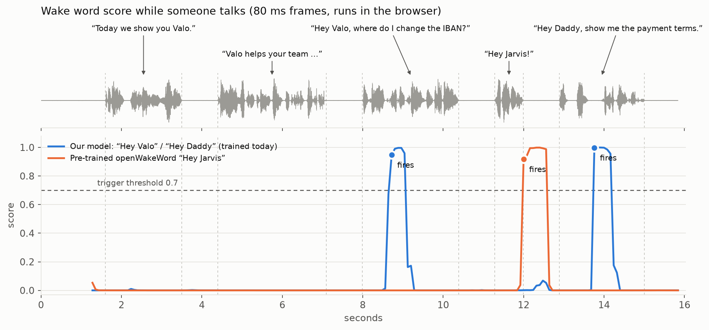

# Wake word "Hey Valo" / "Hey Daddy" — training pipeline

Our own keyword model for the Valo extension, trained on the hackathon day in ~30 minutes on a laptop.
Shipped model: [`apps/extension/public/wakeword/hey_valo_daddy_v1.onnx`](../../apps/extension/public/wakeword/hey_valo_daddy_v1.onnx)
(identical to [`results/hey_valo_daddy_v1.onnx`](results/hey_valo_daddy_v1.onnx)). Decision: [D-38](../../docs/decisions.md).

## Privacy by construction

- **No human voice recordings.** All training audio is synthetic (Gemini TTS + local macOS voices). No employee,
  customer or team member was recorded; there is no personal data in the training set.
- **Runs on the device.** The model is 400 KB of ONNX and runs inside the browser (ONNX Runtime Web, extension
  offscreen document). The microphone stream is scored locally every 80 ms and **no audio leaves the device before
  the wake word fires**; only then does the spoken question go to transcription.
- **Our own weights.** Unlike the pre-trained `hey_jarvis` (CC BY-NC-SA 4.0), this head is our own work.

## How it works

```
synthetic speech ──► augmentation ──► openWakeWord features ──► MLP head ──► ONNX ──► browser
 30 Gemini voices     speed ±15 %       mel → embedding          1536-64-64-1    400 KB     next to "Hey Jarvis",
 33 macOS voices      reverb, mic EQ    (16 × 96 per window,     102,849 params             highest score wins
 de + en              noise, babble     exactly as in the browser)
```

1. **Data** (`generate_gemini.py`, `generate_macos.py`, texts in `phrases.py`): positives with plain text only
   ("Hey Valo", "Hey, Daddy." …), near misses ("Hey Danny", "Hey Paolo", "Valo" alone), office sentences in English
   and German, and **hard negatives** added after the first model fired on pitch sentences ("Today we show you
   Valo."). Every clip is listed in [`data/manifest.csv`](data/manifest.csv) (1,632 clips: file, label, kind, voice, text).
2. **Features** (`features.py`): each clip is augmented 3–10× and run through the *same* streaming pipeline as
   [`wakeword.ts`](../../apps/extension/utils/voice/wakeword.ts) — 80 ms frames, 480 samples context,
   `melspectrogram.onnx`, `embedding_model.onnx` from openWakeWord. Windows that end 80–480 ms after the wake word
   are positive; everything before it, everything ≥ 1.2 s after it (no second trigger) and every window of a
   negative clip is negative.
3. **Training** (`train.py`): small MLP, negatives weighted 2× (a false trigger is worse than repeating "Hey Valo"),
   14 epochs, ~45 s on a laptop CPU. Exported to ONNX with the same input/output shape as openWakeWord's own heads.
4. **Evaluation** (`evaluate.py`): first trained **without** 14 held-out voices, then tested clip by clip on them;
   the shipped model is the same recipe trained on everything.

## Results (held-out voices, threshold 0.7)

| Set | Clips | Fired | Rate |
| --- | --- | --- | --- |
| Wake word ("Hey Valo" / "Hey Daddy") | 72 | 69 | **95.8 %** |
| Office and pitch sentences | 79 | 0 | **0 %** |
| Hard negatives ("Today we show you Valo.", "Valo hilft dir weiter." …) | 35 | 1 | 2.9 % |
| Near misses ("Hey Danny", "Hey Daniel", "Hey Paolo" …) | 74 | 5 | 6.8 % |

Full list of misses and false triggers: [`results/eval.md`](results/eval.md) · numbers: [`results/eval.json`](results/eval.json).
Known weak spots: near-homophones ("Hey Danny") and strongly accented synthetic voices.



Samples (16 kHz WAV, held-out voice): [`positive_hey-valo`](samples/positive_hey-valo_Vindemiatrix.wav) ·
[`positive_hey-daddy`](samples/positive_hey-daddy_Vindemiatrix.wav) ·
[`negative_today-we-show-you-valo`](samples/negative_today-we-show-you-valo_Vindemiatrix.wav) ·
[`negative_wir-zeigen-euch-heute-valo`](samples/negative_wir-zeigen-euch-heute-valo_Vindemiatrix.wav).
The chart's audio is in [`samples/timeline`](samples/timeline).

## Reproduce

```bash
cd ml/wakeword && python3 -m venv .venv && .venv/bin/pip install -r requirements.txt
.venv/bin/python generate_gemini.py      # needs GEMINI_API_KEY (env or repo-root .env.local), ~3 min
.venv/bin/python generate_macos.py       # macOS only (`say`), ~5 min
.venv/bin/python features.py && .venv/bin/python train.py && .venv/bin/python evaluate.py
.venv/bin/python train.py --final --ship && .venv/bin/python evaluate.py --chart
```

Needs `npm install` at the repo root first (the openWakeWord feature models come from `node_modules/openwakeword-wasm-browser`).
TTS output is not deterministic, so a rerun gives a slightly different model.
